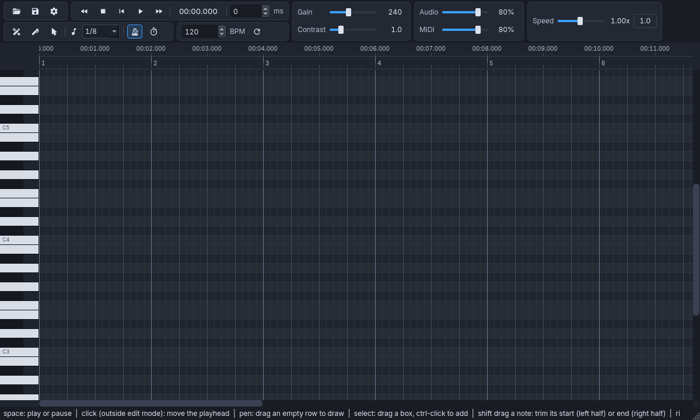

# Namioto

Namioto is an open-source, WaveTone-style editor for transcribing audio into MIDI notes.
View a pitch spectrum behind a piano roll, listen to the recording, and draw or adjust
notes against what you hear and see.



## What you can do

- Transcribe by hand with a pitch spectrum, slowed-down playback and a snap grid.
- Import MIDI and edit up to 16 channels with separate instruments, colours and mute controls.
- Extract singing-voice notes with [GAME](https://github.com/openvpi/GAME).
- Add lyrics and readings, adjust their note mapping, and export karaoke ASS subtitles.
- Save your work as a `.nto` project; export MIDI, KRC lyrics or ASS subtitles.
- Run analysis and exports from the command line, or control a running editor remotely.

## Feature previews

### Transcribe against the spectrum

The editor above shows a vocal's pitch spectrum, editable MIDI notes and the channel sidebar.
Slow playback down, adjust the grid, and check notes against the recording.

### Map lyrics onto notes

Readings appear on notes, while the lyrics strip shows how sounds share or consume note slots.
Edit the mapping directly, with each gesture kept as one undo step.


### Extract notes and align lyrics

GAME offers automatic singing-voice transcription; alignment helps map known lyrics against a
separated vocal. These previews show the setup dialogs, not completed inference runs.

| Singing-voice transcription | Lyrics alignment |
| --- | --- |
|  |  |

### Export karaoke subtitles

Export the mapped lyrics as ASS, with timing, font, layout and per-channel highlight options.
See the [lyrics guide](docs/lyrics.md) for the editing and export workflow.


## Install and launch

You need [uv](https://docs.astral.sh/uv/), Python 3.14, and a C++17 compiler.
For a source checkout, first follow the [source setup prerequisites](docs/development.md#source-setup).
From the cloned repository directory, run:

```bash
uv sync --extra cpu
uv run namioto
```

To open a recording or an existing project directly:

```bash
uv run namioto song.mp3
uv run namioto song.nto
```

The CPU setup is the simplest starting point. Some analysis tasks download models on first
use and need an internet connection. See [analysis devices and models](docs/cli.md#devices-and-models)
for GPU options.

**To hear MIDI notes**, run an external software MIDI synthesiser such as TiMidity or
FluidSynth. Without a recognised synth, notes are silent; recording playback still works.

## Your first transcription

1. Click **Open** (`Ctrl+O`) and choose an audio file. Choose where to save its `.nto`
   project and accept the analysis options to start.
2. Wait for the spectrum to appear. Adjust **Gain** and **Contrast** to make the pitches
   easier to see.
3. Press `Space` to play or pause. Lower **Speed** to listen more slowly without changing
   pitch. If a tempo suggestion appears, accept it or enter the BPM yourself.
4. Select the **Pen** tool to enter edit mode. Drag across an empty area to draw a note;
   drag a note to move it, or its edge to resize it. Set **Snap** to the note length you need.
5. Save with `Ctrl+S`. Use **Export → Export MIDI…** when you want to use the notes elsewhere.

The project stores a reference to the audio, not a copy: keep the recording available when
moving your project. Changing BPM moves the beat grid, not the notes.

**Exchanging MIDI with another application?** Disable **WaveTone compatibility** in Settings.
It is enabled by default and adds/removes WaveTone's leading bar.

## Guides

| Guide | What it covers |
| --- | --- |
| [Using the editor](docs/usage.md) | Projects, spectrum, editing shortcuts, playback, channels and settings |
| [Lyrics and karaoke](docs/lyrics.md) | KRC import, readings, alignment, mapping and ASS export |
| [Command-line tools](docs/cli.md) | Analysis, subtitle export, watch mode and remote control |
| [Development](docs/development.md) | Source setup, tests, packaging and model conversion |

## License

Namioto is licensed under **GNU AGPL v3.0**. See [LICENSE](LICENSE) and [NOTICE](NOTICE)
for licensing and third-party attributions.

Downloaded analysis models have separate licenses, including **non-commercial** restrictions.
They are not bundled with the program. Check [NOTICE](NOTICE) before using model-assisted
results commercially.
