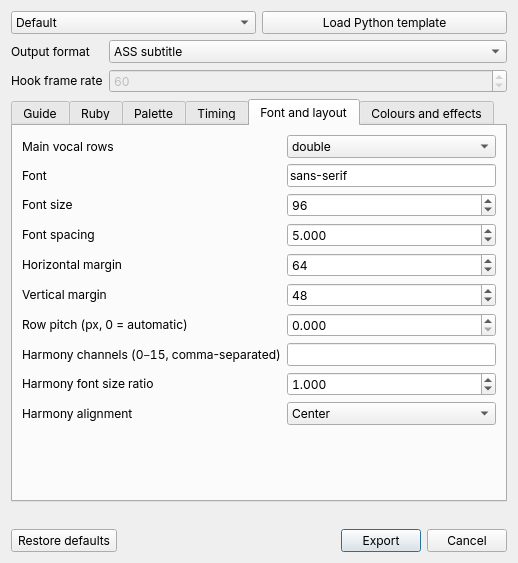

# Lyrics and karaoke

[README](../README.md) · [Editor guide](usage.md) · [CLI](cli.md)

## Add project lyrics

Open the lyrics window with the text-box button beside the GAME wand. The **Project lyrics
(.krc)** box is the authoritative text stored in the project.

1. Use **Import .krc…**, or paste KRC text into the project lyrics box.
2. Review the text and save it to the project.
3. Save the `.nto` to keep the lyrics with your notes.

For plain lyrics, expand the plain-text panel and paste text or use **Load text…** for
`.txt`, `.md` or `.lrc`. Then choose either:

- **Copy prompt**: paste the prompt into a model of your choice, then paste its answer into
  the project lyrics box.
- **Convert with the API**: configure an OpenAI-compatible API base (through `/v1`), key and
  model in Settings → Lyrics. The conversion streams output and validates the result before
  applying it. Invalid results are retried; an unsuccessful conversion leaves lyrics unchanged.

Conversion adds kana readings to kanji. Plain text is an input to conversion, not a replacement
for the project's KRC. The API key is stored in plain text in the settings file.


## Edit externally

**Open in external editor** opens a temporary UTF-8 `.krc` copy with the configured editor,
or the platform default. External saves are validated and reloaded without reopening the
project or running alignment. Broken external text remains available to fix, but the lyrics
window will not save invalid KRC into the project.

Temporary copies are removed when the document closes. Existing `.krc` files beside the
project are not modified; import them explicitly if needed.

## Map lyrics to notes

Lyrics follow the KRC's `.N` counts and shared-sound groups. Each channel consumes its own
notes in order. Editing text or notes does not automatically run alignment or rebuild the
mapping; inserting or deleting a note can shift subsequent lyrics.

The lyrics strip uses separate channel lanes above the roll. Green blocks sit on mapped
notes; red marks doubtful mapping; grey labels with no block consume no notes. Unmatched
labels have dashed outlines in the lower row.

| Gesture | Effect |
| --- | --- |
| Drag a boundary | Redistribute NOTE slots between adjacent units, preserving their total |
| Shift-drag left half | Exchange slots with the immediate left neighbour |
| Shift-drag right half | Change the unit's count without changing the next unit's count |
| Drag a Sound into an adjacent group | Join it while retaining the receiving group's NOTE count |
| Pull an edge Sound out of a group | Split it into an independent one-NOTE unit |
| Drag to the lower row | Drop a Sound to zero NOTE slots |
| Drag a zero-count label to upper empty space | Restore one NOTE slot |
| Right-click → Lyric channel | Change channel ownership |
| Escape | Cancel the gesture |

To split an edge Sound, release after crossing its group's boundary. To merge it elsewhere,
continue into the middle half of the receiving unit. Sound order never changes. Each gesture
changes the KRC in one undo step.

If notes run out, the display uses those available and preserves requested counts for later.
Incomplete mappings can be saved and edited, but cannot be exported as subtitles.


## Align against a vocal

Use a separated singing voice for alignment, not a full mix. With lyrics and audio loaded,
the clock button opens **Align** for the selected channel.

- **Auto-map** uses alignment while respecting explicit KRC counts and shared-sound groups.
- **Align** replaces the current mapping with the structure computed from the vocal.

Successful mapping updates KRC in one undo step without automatically saving the project.
Other channels retain their mapping and alignment evidence. Low-confidence results are marked
for review; the raw timing overlay lets you inspect evidence without changing it.

Model, device and chunking choices are remembered. Each Align run reads the current lyrics with
their NOTE counts and mapping groups removed, finds the sounds in the audio, and assigns them
to the current MIDI notes using the measured times. Only the model's pass over the audio is
cached. Evidence is saved in the `.nto` alongside notes and lyrics.


For token-window input and headless alignment, see [CLI alignment](cli.md#align-a-vocal).

## Assign lyric channels

Use `@N{lyrics}` for MIDI channel `N` (0–15). Unwrapped lyrics use channel 0. The number is
the MIDI channel, not a track's position in the file.

```text
@0{あいう} @1{えお}
@1{
かき
くけ
}
```

Wrappers can span lines but cannot nest. Newlines still start new subtitle display lines;
inline wrappers keep text on the same line. Ruby, groups, NOTE counts, comments and chapter
breaks keep their meaning. A Sound or a shared-NOTE group must belong to one channel.
Different channels can sing simultaneously.

## Export lyrics and subtitles

Use **Export → Export lyrics (.krc)…** for mapped KRC, or **Export karaoke…** for styled lyrics. Choose the default template, single or alternating double rows, and ASS or hook output. The next export opens with the format of the last successful export. The editor takes a KRC/MIDI snapshot and uses the same mapping as file export. Independent words on one line can sing simultaneously. Multiple readings of a shared base retain their own ordered time intervals.

The sweep follows the measured text during its singing interval. The engine handles outlines and halos automatically. Sweep transition width sets the width of the colour blend at the moving edge in canvas pixels.

The default uses white lettering, channel-coloured highlights, outlines and a halo. Turn off **Use project channel colours** to override the sung colour or individual channels for this export. Ruby size is relative to the main font; its gap is measured between visible outlines. Preview controls how early a line appears, and hold extends its tail before the line fades as a group. In the default double-row layout, each KRC chapter starts on the left and subsequent main-vocal lines alternate sides. Automatic row spacing leaves 20% of the track’s largest body font size between the measured boxes of rows visible together. Only readings present on those rows take up space. Each row stays in place for its full display interval. The section count-in can use three filling dots, descending bars or flashing volume columns. A lyric row with an inline count-in appears when its first countdown step begins and stays visible as singing starts. An independent count-in reserves space above its main lyric row, including any ruby. Guide size follows the authored lyric font size at the marker. A ratio of 0.5 gives a 50 px dot diameter or bar height at size 100, and 40 px at size 80. Automatic guide clearance is one eighth of the authored font size. Set the guide gap to -1 for automatic spacing, or enter a distance in pixels. A per-symbol duration of zero follows MIDI tempo.

A KRC bracket starts a reading group that may extend on both sides of its base. Comma-separated parts inside one bracket keep their own timings and share the group. This corresponds to Aegisub’s float-left marker at the start of a word.

The default singing pulse scales the body glyphs around their own centers over the lyric unit. Each ruby glyph pulses around its own center as the wipe reaches its part of the reading. Other ruby glyphs stay in place, including during gaps between readings. Set the singing scale multiplier to 1 to turn off both pulses.



See [CLI export](cli.md#export-karaoke) for file and session exports and [Python templates](karaoke-templates.md) for custom recipes.
