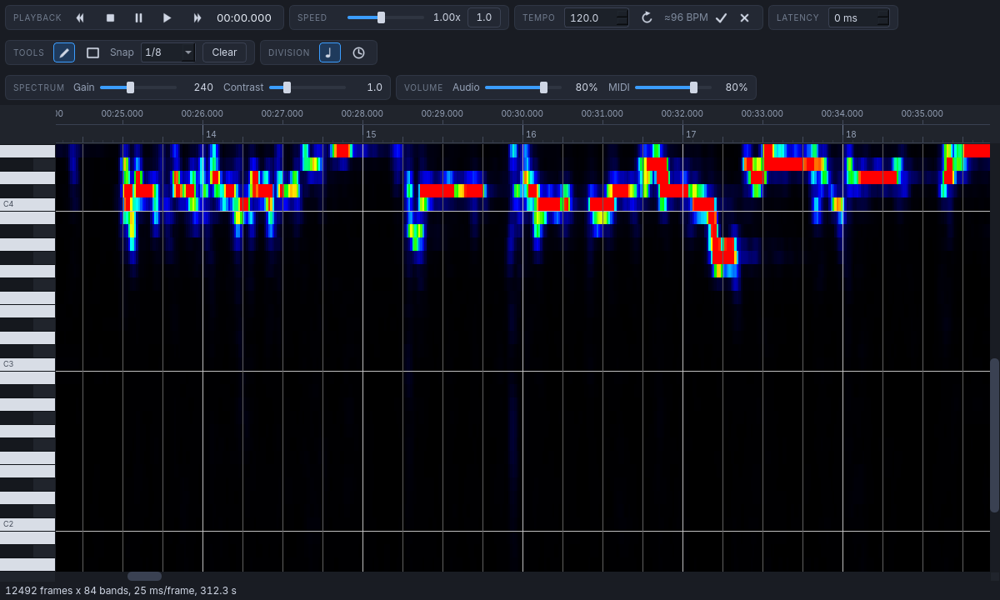
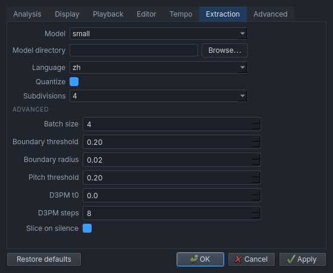

# Using the editor

[README](../README.md) · [Lyrics](lyrics.md) · [CLI](cli.md)

## Projects and files

Use **Open** (`Ctrl+O`) to open audio or a `.nto` project. Opening audio asks for a project
location and analysis options, then creates the project. MIDI files are imported into an
open project, not opened as standalone projects.

- **Save**: `Ctrl+S`; **Save As**: `Ctrl+Shift+S`.
- **Export**: MIDI, KRC lyrics or ASS subtitles. Exporting does not replace saving the project.
- A `*` in the title means there are unsaved changes. Switching projects or closing asks
  before discarding them. An unnamed sketch closes without asking.

A `.nto` is a plain JSON file containing notes, lyrics, the audio path and project-specific
settings. Audio is referenced rather than copied; paths are relative when possible. A project
with missing audio still opens its notes and reports the missing recording.

Notes are saved in seconds. Changing BPM changes the grid without changing their timing.
View and volume changes are saved but do not mark the project as dirty.

## Spectrum

The spectrum displays energy across note bands C1–B7, from dark blue through green to red.
Analysis runs in the background, with progress in the status bar.

- **Gain** changes how much energy reaches full red.
- **Contrast** changes the balance between weak and strong energy.
- Audio channels, frame rate, FFT window and tuning are selected when opening audio.
- **Overtone highlight** marks the hovered pitch and its first overtones.

## Playback and tempo

Press `Space` to play or pause. **Audio** controls the recording volume; **MIDI** controls
note volume through an external synth. Without a recognised software MIDI synth, notes are
silent and the MIDI volume control is disabled. Its tooltip identifies the selected synth.

**Speed** ranges from 0.10× to 2.00× without changing pitch. The reset button returns to 1.00×.
Clicking a piano key or a pitch row auditions that pitch when a synth is available.

When stopped, pressing or dragging in the roll moves the playhead while editing. During
playback, roll edits do not seek: click the timeline ruler to seek instead.

Loading audio estimates tempo but does not apply it automatically. Accept or dismiss the
suggestion next to BPM; use the round arrow to estimate again. Right-click the BPM field
(or press `*` / `/` while it has focus) to double or halve it.

**Grid offset (ms)** moves the grid and snapping, not the audio or note timestamps.
**Time division** switches the axis between beats/bars and seconds.

## Editing notes

Choose **Pen** or **Select** to enter edit mode. Outside edit mode, the roll shows the spectrum
without notes and clicks move the playhead. Snap and quantize remain available in either mode.

| Action | Input |
| --- | --- |
| Draw | Pen: left-drag empty space |
| Move | Left-drag a note; a selection moves together |
| Resize | Drag an edge, or Shift-drag the left/right half |
| Select | Left-click a note |
| Add to selection | Ctrl-click |
| Box select | Select tool: drag empty space; Ctrl-drag with either tool |
| Select all | `Ctrl+A` |
| Delete | Right-click a note, or `Delete` / `Backspace` |
| Copy / paste | `Ctrl+C` / `Ctrl+V`; paste starts at the playhead |
| Cancel a drag | `Escape` |
| Pan | Middle-drag, scrollbars, or drag the timeline ruler |
| Zoom time | Ctrl-wheel |
| Zoom pitch | Ctrl-Shift-wheel |
| Scroll time / pitch | Wheel / Shift-wheel |

**Snap** sets the grid for drawing, moving and resizing. Moving preserves a note's offset
within its snap cell. **Quantize** moves starts and ends onto the grid: it affects selected
notes, or all notes when there is no selection, and skips locked channels. Resizing and
quantizing keep notes at least one snap cell long.

Paste aligns the first note to the grid and quantizes the spacing within the copied block.

## MIDI channels and import

The layers button opens the channel sidebar. Click a card to make it the drawing channel;
double-click its name to rename it. Each card offers an instrument, lock, visibility and mute.
The context menu adds or deletes channels and sets channel volume. The final channel cannot
be deleted. Up to 16 MIDI channels are available, including percussion.

- **Lock** prevents editing.
- **Hide** changes drawing only; hidden notes still export.
- **Mute** silences playback.

MIDI import preserves the audio, view and snap grid. If notes already exist, choose **Replace**
or **Merge**. Merge lets you map incoming MIDI channels to existing or new channels. Unsupported
content, such as later tempo changes or unterminated notes, is counted in the status bar.

Export writes one track per channel at the project tempo. Channel names are project-only:
they are neither imported from nor exported to MIDI track names.

**WaveTone compatibility** is on by default. It removes WaveTone's leading bar on import
and adds it on export. Disable it for ordinary MIDI exchange with other tools.

## Settings and remembered values

The gear opens Settings. Changes to interface language take effect on the next run.

| Page / option | Purpose |
| --- | --- |
| General | Language, auto-save and widget style |
| Devices | GPU backend and runtime availability |
| Tempo | Estimation algorithm; WaveTone is the default |
| WaveTone compatibility | Leading-bar handling for MIDI |
| Network | GitHub download mirror and HTTP proxy |
| Lyrics | OpenAI-compatible endpoint and external KRC editor |
| ASS subtitle | Font, colours, fades, lead time and guide dot |
| Remote | Local remote control, enabled by default |

Auto-save is off by default. When enabled, it saves the open project after editing stops and
when the window loses focus. **Apply** applies settings without closing; **Restore defaults**
resets them.

Project-specific analysis, display, playback and view values live in the `.nto`. Preferences
live in `~/.config/namioto/settings.json`; window state and new-project habits live in
`~/.config/namioto/state.json`. `$NAMIOTO_SETTINGS` and `$NAMIOTO_STATE` override those paths.
Opening a project does not overwrite new-project habits.

The GUI options `--channels`, `--t-num`, `--gain` and `--contrast` override values for one run
without updating preferences. For automated workflows, see the [CLI guide](cli.md).
